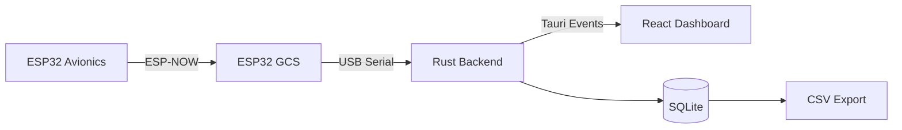
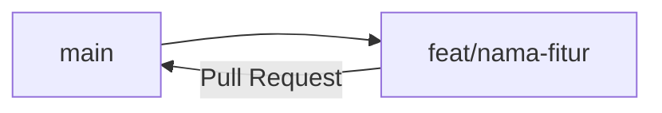

<div align="center">

  <h1 align="center">🚀 Avionics Telemetry & Ground Control System</h1>

  <p align="center">
    Sistem telemetry roket berbasis ESP32 dengan Ground Control Station desktop
    <br />
    <br />
    <a href="#-instalasi">Instalasi</a>
    ·
    <a href="#-git-workflow">Git Workflow</a>
    ·
    <a href="#-keselamatan">Keselamatan</a>
  </p>

</div>

---

## 📡 Gambaran Sistem

Sistem ini membaca data sensor pada roket, mengirimkannya secara nirkabel ke Ground Control Station (GCS), menampilkan telemetry secara real-time, dan menyimpan data untuk analisis setelah pengujian.



| Komponen         | Peran                                                    |
| ---------------- | -------------------------------------------------------- |
| ESP32 Avionics   | Terpasang di roket, membaca sensor, kirim via ESP-NOW    |
| ESP32 GCS        | Menerima data ESP-NOW, meneruskan ke laptop via Serial   |
| Aplikasi Desktop | Dashboard telemetry, penyimpanan data, ekspor, kontrol   |

Frontend tidak membaca serial secara langsung. Semua akses perangkat lewat Rust backend.

---

## 📊 Status Project

| Bagian                      | Status         |
| --------------------------- | -------------- |
| Struktur repository         | Selesai        |
| Setup Tauri 2 + React + TS  | Selesai        |
| Firmware Avionics dan GCS   | Belum dimulai  |
| Serial reader (Rust)        | Belum dimulai  |
| Dashboard real-time         | Belum dimulai  |
| SQLite dan CSV export       | Belum dimulai  |
| GitHub Actions (CI/CD)      | Rencana        |
| Ground Control              | Rencana        |

Hal yang masih ditentukan nanti: sensor tambahan selain MPU6050, sampling rate, frekuensi kirim telemetry, skema database, pinout, dan mekanisme otorisasi kontrol.

---

## 🚀 Instalasi

### Prerequisites

- Node.js (LTS)
- pnpm (aktifkan lewat Corepack, lihat di bawah)
- Rust (install lewat [rustup](https://rustup.rs))
- Git
- Dependency Tauri sesuai OS:
  - Windows: WebView2 (biasanya sudah ada di Windows 10/11)
  - Linux: WebKitGTK dan paket pendukung, lihat [panduan Tauri](https://tauri.app/start/prerequisites/)
  - macOS: Xcode Command Line Tools
- [PlatformIO](https://platformio.org) untuk firmware

### Quick Start (Desktop)

Aktifkan pnpm lewat Corepack (sekali saja):

```bash
corepack enable
```

Lalu jalankan:

```bash
git clone <repository-url>
cd <nama-repo>/software/desktop
pnpm install --frozen-lockfile
pnpm tauri dev
```

Build Rust pertama kali bisa memakan waktu beberapa menit, itu normal.

### Commands

```bash
pnpm tauri dev          # Menjalankan aplikasi desktop (mode development)
pnpm build              # Build frontend
pnpm tauri build        # Build installer aplikasi desktop
cargo check             # Cek kode Rust (jalankan dari src-tauri/)
```

### Firmware

Firmware memakai C++ dengan Arduino Framework dan dikelola dengan PlatformIO. Konfigurasi board dan pinout didokumentasikan di folder firmware masing-masing setelah hardware final.

```bash
cd hardware/avionics/firmware
pio run                 # Compile firmware avionics

cd ../../gcs/firmware
pio run                 # Compile firmware GCS
```

---

## 📦 Format Data

ESP32 GCS mengubah data yang diterima menjadi JSON sebelum dikirim lewat USB Serial. Contoh struktur (hanya contoh format, bukan hasil pengukuran):

```json
{
  "device_id": "avionics_01",
  "sequence": 1024,
  "timestamp": 123456,
  "sensor": {
    "accel_x": 0.12,
    "accel_y": 0.24,
    "accel_z": 9.81,
    "gyro_x": 0.01,
    "gyro_y": 0.02,
    "gyro_z": 0.03
  }
}
```

Sistem harus menangani paket hilang, duplikat, tidak berurutan, data tidak valid, dan koneksi terputus.

---

## 🛡️ Keselamatan

Project ini melibatkan ejection charge, jadi aspek keselamatan menjadi prioritas pada fitur Ground Control:

- Kontrol hanya untuk operator berwenang.
- Setiap perintah butuh konfirmasi eksplisit.
- Perintah divalidasi terhadap kondisi keselamatan dan interlock.
- Kehilangan koneksi tidak dianggap sebagai kondisi aman.
- Status perintah dibedakan dari konfirmasi pelaksanaan.
- Semua aktivitas kontrol dicatat.
- Pengujian software memakai simulasi atau dummy load yang aman.
- Pengujian aktual mengikuti prosedur dan persetujuan penanggung jawab.

---

## 🔄 Git Workflow

### Branch Utama

- `main` : branch stabil.
- `feat/*`, `fix/*`, dst. : branch kerja, dibuat dari `main` dan digabung lewat Pull Request.



### 📋 Pull & Push Schema

| Step | Action                               | Description                   |
| ---- | ------------------------------------ | ----------------------------- |
| 1️⃣   | `git switch main`                    | Pindah ke branch `main`       |
| 2️⃣   | `git pull --ff-only origin main`     | Ambil perubahan terbaru       |
| 3️⃣   | `git switch -c feat/nama-fitur`      | Buat feature branch           |
| 4️⃣   | 💻 Code                              | Mulai coding                  |
| 5️⃣   | `git commit -m "feat: message"`      | Commit perubahan              |
| 6️⃣   | `git push -u origin feat/nama-fitur` | Push feature branch           |
| 7️⃣   | 📝 Create PR                         | Buat Pull Request ke `main`   |
| 🏁   | ✅ Done!                             | Selesai!                      |

### Release

Release desktop dipicu oleh Git tag dengan pola `v*` (contoh: `v0.1.0`). Workflow ini masih dalam tahap perencanaan.

---

## 📝 Naming Conventions

### 🌿 Branch Naming

```text
<type>/<short-description>
```

**Types:**

- `feat` : fitur baru
- `fix` : perbaikan bug
- `docs` : perubahan dokumentasi
- `refactor` : perubahan struktur kode
- `chore` : tooling dan konfigurasi

**Examples:**

```bash
feat/espnow-telemetry
feat/live-chart
fix/serial-reconnect
docs/update-readme
```

### 💬 Commit Messages

Gunakan format Conventional Commits:

```text
<type>(<scope>): <short-summary>
```

**Examples:**

```bash
feat(avionics): add espnow sender
feat(desktop): add serial reader
fix(gcs): handle malformed packet
docs(readme): update installation guide
chore(ci): add software workflow
```

---

## 📁 Folder Structure

```text
📦 project-root/
├── 📂 .github/
│   └── 📂 workflows/          # GitHub Actions (hardware-ci, software-ci, desktop-release)
├── 📂 hardware/
│   ├── 📂 avionics/
│   │   └── 📂 firmware/       # Firmware ESP32 di roket
│   └── 📂 gcs/
│       └── 📂 firmware/       # Firmware ESP32 di GCS
├── 📂 software/
│   └── 📂 desktop/
│       ├── 📂 src/            # Frontend React + TypeScript
│       ├── 📂 src-tauri/      # Backend Rust (Tauri 2)
│       └── 📄 package.json
├── 📄 README.md
└── 📄 .gitignore
```

Dokumentasi protokol dan konfigurasi hardware ditulis di README masing-masing bagian.

---

## 📋 Coding Standards

### Naming Rules

| Type            | Convention       | Example                |
| --------------- | ---------------- | ---------------------- |
| React component | PascalCase       | `TelemetryChart.tsx`   |
| Functions (TS)  | camelCase        | `parsePacket()`        |
| Variables (TS)  | camelCase        | `lastSequence`         |
| Constants       | UPPER_SNAKE_CASE | `TELEMETRY_RATE_HZ`    |
| Folders         | kebab-case       | `flight-history/`      |
| Rust / C++      | snake_case       | `read_serial_port()`   |

### General Rules

- Gunakan `.ts` dan `.tsx` untuk frontend, tidak ada `.js` atau `.jsx`.
- Frontend tidak mengakses serial langsung, semua lewat backend Rust.
- Jangan commit secret, file `.db`, atau data hasil pengujian.
- Jangan hardcode pinout atau konfigurasi hardware di banyak tempat, taruh di satu file konfigurasi.
- Gunakan `pnpm` saja, jangan campur dengan `npm` atau `yarn`. Commit `pnpm-lock.yaml`.
- Pastikan `pnpm build` dan `cargo check` lulus sebelum membuat Pull Request.

---

## 🛠️ Tech Stack


Chart memakai Recharts. Data diekspor ke CSV. Target OS: Windows, Linux, macOS.

---

<div align="center">

## 🤝 Kontribusi

Mulai dari `main`, buat branch `feat/*`, dan kirim Pull Request kembali ke `main`.

**Made with ❤️ by Avionics Team**

</div>
