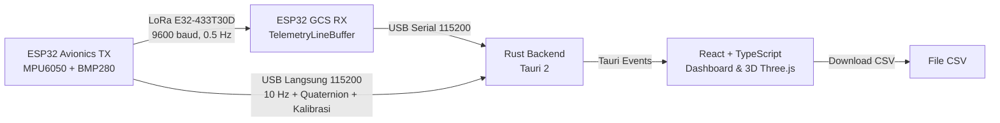

<div align="center">

  <h1 align="center">🚀 Avionics Telemetry & Ground Control System</h1>

  <p align="center">
    Sistem telemetri roket berbasis ESP32 (MPU6050 + BMP280 + LoRa E32) dengan aplikasi desktop Tauri 2 + React
    <br />
    <br />
    <a href="#-gambaran-sistem">Gambaran Sistem</a>
    ·
    <a href="#-fitur-terimplementasi">Fitur</a>
    ·
    <a href="#-instalasi--menjalankan">Instalasi</a>
    ·
    <a href="#-format-data">Format Data</a>
  </p>

</div>

---

## 📡 Gambaran Sistem

Sistem ini membaca data sensor pada roket, mengirimkannya ke laptop melalui **USB Serial langsung** atau **radio LoRa E32-433T30D**, menampilkan telemetri serta orientasi 3D secara *real-time* pada aplikasi desktop, dan mengekspor seluruh riwayat sesi ke file CSV.



| Komponen | Peran Saat Ini |
| --- | --- |
| **ESP32 Avionics (TX)** | Membaca MPU6050 (100 Hz) & BMP280 (10 Hz) via I2C, menjalankan filter quaternion & kalibrasi 6-pose (NVS `imu-cal-v2`), mengirim JSON via USB Serial (10 Hz) dan LoRa E32 (tiap 2 detik). |
| **ESP32 GCS (RX)** | Menerima stream UART dari LoRa E32, merakit potongan paket hingga `\n`, memvalidasi pembungkus objek JSON `{...}`, dan meneruskannya ke laptop via USB Serial. |
| **Rust Backend (Tauri 2)** | Membuka/menutup port serial lintas OS (`COM*`, `/dev/tty*`, `/dev/cu.*`), mem-parse JSON, menghitung altitude relatif & sudut Euler, mendeteksi putus koneksi, dan menulis ekspor CSV. |
| **React Dashboard** | Menampilkan metrik penerbangan, 4 grafik sensor *real-time*, visualisasi roket 3D (Three.js), wizard kalibrasi IMU 6-pose, log serial, mode *Dummy Data*, dan ekspor CSV. |

> Frontend tidak mengakses port serial secara langsung. Semua pembacaan dan pengiriman perintah perangkat melewati backend Rust.

---

## ✅ Fitur Terimplementasi

| Bagian | Status & Rincian |
| --- | --- |
| **Firmware Avionics TX** (`imu3d-v2`) | Pembacaan MPU6050 (`±8 g`, `±500 °/s`, DLPF 21 Hz) & BMP280 via I2C (`SDA=GPIO21`, `SCL=GPIO22`), filter orientasi quaternion, kalibrasi 6-posisi tersimpan di NVS, output USB 10 Hz, dan pemancar LoRa E32 (`RX=16`, `TX=17`, `AUX=27`, `M0=25`, `M1=26`) setiap 2 detik. |
| **Firmware GCS RX** | Receiver UART2 E32 (`9600 baud`) dengan `TelemetryLineBuffer` (kapasitas 512 byte) yang meneruskan JSON valid ke USB (`115200 baud`). Meneruskan command pulsa D19 dari USB ke radio dan ACK avionics kembali ke software. Kalibrasi tetap melalui USB langsung ke avionics. |
| **Serial Reader & Parser (Rust)** | Enumerasi port USB/Serial, reader thread non-blocking dengan penanganan disconnect, validasi `imuValid` & nilai finite, kalkulasi ketinggian barometrik relatif (titik `0 m` pada tekanan valid pertama tiap sesi `Start`), serta konversi quaternion ke Euler ZYX. |
| **Dashboard Real-Time (React + TS)** | Kartu metrik (**Altitude**, **Descent rate** regresi linier 6 sampel, **Packet count**, **Lost packets** adaptif 10 Hz USB / 0.5 Hz LoRa), 4 grafik sensor Recharts (*Temperature*, *Pressure*, *Gyroscope*, *Accelerometer* dengan skala Y dinamis), kartu **Attitude** (`YAW`, `PITCH`, `ROLL`), tema Light/Dark, dan mode **Dummy Data**. |
| **Visualisasi 3D & Kalibrasi IMU** | Model roket 3D WebGL (Three.js) dengan *on-demand rendering* dan interpolasi `slerp`, tombol *Luruskan pose sekarang* (`IMU_REFERENCE`), serta dialog **Kalibrasi IMU 6-Posisi** (±X, ±Y, ±Z) melalui USB langsung ke ESP32 Avionics. |
| **Serial Log & Ekspor CSV** | Panel **Serial log** (*Status*, *Raw data*, dan *Serial history* hingga 200 baris) serta tombol **Download CSV** yang mengekspor riwayat penuh sesi (hingga 100.000 titik). |

> **Catatan cakupan saat ini:**
> - Panel **Command (Arm / Fire)** mengirim pulsa D19 lewat radio dengan durasi pilihan operator (1–10000 ms, default 200 ms). Status FIRED menunggu ACK avionics; pengujian fisik jalur FIRE belum dikonfirmasi. Lihat [protokol dan hasil validasi](docs/lora-bidirectional.md).
> - Link memakai guard, prioritas ACK, dan retry; belum ada polling/slot waktu bersama untuk menjamin giliran TX/RX. Paket masih dapat bertabrakan dengan telemetri.
> - Kartu **Map view**, **Magnetometer**, dan **Orientation** di grid sensor masih berupa *placeholder* UI.
> - Kalibrasi IMU, status/profil 3D, dan quaternion hanya berjalan melalui koneksi **USB langsung** ke ESP32 Avionics; jalur **LoRa E32** membawa telemetri sensor dasar tiap sekitar 2 detik serta command D19/ACK.

---

## 🚀 Instalasi & Menjalankan

### Prerequisites

- **Node.js** (LTS) dan **pnpm** (`corepack enable`)
- **Rust** ([rustup](https://rustup.rs))
- **Dependency Tauri sesuai OS**:
  - Windows: WebView2 (bawaan Windows 10/11)
  - Linux: WebKitGTK dan paket pendukung ([panduan Tauri](https://tauri.app/start/prerequisites/))
  - macOS: Xcode Command Line Tools
- **PlatformIO** untuk kompilasi dan upload firmware ESP32

### Aplikasi Desktop (Tauri + React)

```bash
cd software
pnpm install --frozen-lockfile
pnpm tauri dev
```

Perintah pengembangan lainnya (dari folder `software/`):

```bash
pnpm build          # Typecheck TypeScript & build frontend
pnpm test           # Jalankan unit test frontend (node --test)
pnpm tauri build    # Build installer aplikasi desktop
```

Untuk memeriksa dan menguji backend Rust (dari `software/src-tauri/`):

```bash
cargo check
cargo test --lib
```

### Firmware ESP32 (TX & RX)

Dari root repository (Linux/macOS/Git Bash):

```bash
./hardware/telemetry.sh build
./hardware/telemetry.sh flash tx /dev/ttyUSB0
./hardware/telemetry.sh flash rx /dev/ttyACM0
./hardware/telemetry.sh monitor rx /dev/ttyACM0
./hardware/telemetry.sh test
```

Atau bekerja langsung dari folder firmware masing-masing:
- Transmitter: [hardware/avionics/firmware/README.md](hardware/avionics/firmware/README.md) (`./firmware.sh build|ports|flash|monitor` dan `./test-host.sh`)
- Receiver: [hardware/gcs/firmware/README.md](hardware/gcs/firmware/README.md) (`./firmware.sh` / `firmware.ps1` dan `./test-host.sh`)

> Hubungkan M0 ke GPIO25, M1 ke GPIO26, dan AUX ke GPIO27 pada kedua ESP32. Firmware memilih NORMAL saat boot; jangan mengikat M0/M1 langsung ke GND jika terhubung ke GPIO. Tutup Serial Monitor sebelum membuka port yang sama dari aplikasi desktop Tauri. Flash firmware terbaru pada TX dan RX.

---

## 📦 Format Data

### 1. Jalur USB Langsung (`imu3d-v2`, 10 Hz)

```json
{"timestampMs":42000,"temperature":30.20,"pressure":994.40,"accelX":0.01000,"accelY":0.02000,"accelZ":9.80600,"gyroX":0.000000,"gyroY":0.000000,"gyroZ":0.000000,"imuValid":true,"calibrated":true,"referenceSet":true,"orientation":[1.0000000,0.0000000,0.0000000,0.0000000],"orientationFrame":"RFU"}
```

### 2. Jalur Radio LoRa E32 (`sensor_telemetry.h`, 0.5 Hz / tiap 2 detik)

```json
{"timestampMs":190047,"temperature":30.60,"pressure":998.64,"accelX":-0.474,"accelY":-0.022,"accelZ":9.182,"gyroX":-0.0557,"gyroY":0.0288,"gyroZ":-0.0168,"imuValid":true,"calibrated":false}
```

- `temperature`: suhu internal chip MPU6050 (°C)
- `pressure`: tekanan BMP280 (hPa), bernilai `null` jika BMP280 tidak tersedia
- `accelX/Y/Z`: percepatan (m/s²)
- `gyroX/Y/Z`: kecepatan sudut (rad/s)
- `orientation`: quaternion `[w, x, y, z]` relatif terhadap acuan awal (bernilai `null` jika belum dikalibrasi/belum ada acuan)

---

## 📁 Struktur Folder

```text
avionics-gcs/
├── docs/
│   ├── hardware-vulnerabilities.md   # Audit kerentanan & keandalan firmware
│   ├── imu-orientation.md            # Panduan kalibrasi 6-pose & protokol serial
│   ├── lora-e32.md                   # Wiring, daya, & konfigurasi E32-433T30D
│   └── lora-bidirectional.md          # Command D19 dan ACK dua arah
├── hardware/
│   ├── telemetry.sh                  # Skrip build/flash/monitor/test TX & RX
│   ├── avionics/firmware/            # Firmware ESP32 Avionics (TX)
│   └── gcs/firmware/                 # Firmware ESP32 GCS Receiver (RX)
├── software/
│   ├── ARCHITECTURE.md               # Arsitektur frontend & optimasi render
│   ├── src/                          # Frontend React + TypeScript + Three.js
│   ├── src-tauri/                    # Backend Rust (Tauri 2)
│   ├── tests/                        # Unit test frontend & regresi layout
│   └── package.json
└── README.md
```

---

## 📚 Dokumentasi Teknis Terkait

- [Panduan Kalibrasi & Orientasi 3D](docs/imu-orientation.md)
- [Panduan LoRa Ebyte E32-433T30D](docs/lora-e32.md)
- [Kontrol D19, ACK, dan Validasi Dua Arah](docs/lora-bidirectional.md)
- [Konfigurasi Pin Hardware](docs/hardware-pinout.md)
- [Arsip Panduan E22](docs/lora-e22.md)
- [Audit Kerentanan Firmware Hardware](docs/hardware-vulnerabilities.md)
- [Arsitektur Frontend Desktop](software/ARCHITECTURE.md)

---

## 🛠️ Tech Stack


