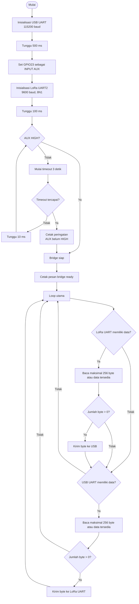

# Flowchart Program E32 Receiver

Flowchart berikut merepresentasikan alur program `e32_receiver.cpp`.

## Ringkasan alur

- ESP32 menginisialisasi USB Serial pada baud rate `115200` dan UART LoRa pada baud rate `9600`.
- Pin `AUX` dibaca untuk memastikan modul E32 siap digunakan.
- Jika `AUX` tetap rendah selama 3 detik, program mencetak peringatan lalu tetap melanjutkan ke mode bridge.
- Pada loop utama, data LoRa diteruskan ke USB dan data USB diteruskan ke LoRa secara transparan, byte-per-byte.
