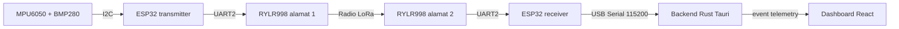

# Panduan MPU6050 + BMP280 → dua ESP32 + RYLR998 → Tauri

> **ARSIP — bukan panduan untuk modul E22-400T30D pengguna.** Firmware aktif
> sudah diganti ke Ebyte E22-400T30D dengan AUX GPIO 23. Ikuti
> [panduan E22 yang berlaku](lora-e22.md). Semua contoh dan keterangan
> implementasi RYLR998 di bawah merujuk versi sebelumnya; jangan diterapkan
> pada E22. E22 memakai protokol, frekuensi, baud bawaan, dan pin mode berbeda.

Panduan ini mengikuti kode proyek yang ada: transmitter memakai firmware di
`hardware/avionics/firmware`, receiver memakai ESP32 DevKit klasik, dan laptop
menjalankan aplikasi Tauri. **Tambahan transmitter sudah diterapkan** di
`src/main.cpp` dan `include/lora_radio.h` firmware avionics; jangan menambahkan
ulang potongan kode transmitter di bawah. Kode receiver masih berupa contoh
untuk diterapkan. Komunikasi radio belum diuji pada dua board fisik.

## Alur dan bagian yang sudah tersedia



Firmware transmitter sudah membaca IMU pada target 100 Hz dan BMP280 pada
target 10 Hz. Backend `software/src-tauri/src/lib.rs` sudah membaca satu JSON
per baris lewat serial dan mengharapkan nama seperti `accelX`, `gyroX`,
`temperature`, dan `pressure`. Altitude dihitung di backend dari tekanan,
dengan nol pada tekanan valid pertama setiap sesi Start.

Langkah awal di bawah mengirim **telemetri sensor 1 Hz**. Pembacaan IMU dan
filter lokal tetap berjalan cepat. Jangan mengirim setiap sampel 100 Hz lewat
LoRa; baud UART 115200 bukan kecepatan efektif radionya.

Model 3D saat ini juga membutuhkan `IMU_STATE`, profil kalibrasi, catatan acuan,
dan quaternion. Panduan telemetri sensor ini belum mengangkut protokol tersebut.
Model 3D dan dialog kalibrasi lewat receiver belum berfungsi dengan contoh ini;
pembacaan accelerometer, gyro, suhu, tekanan, dan altitude dapat diterima Tauri.
Firmware USB langsung di transmitter tetap mempertahankan fitur kalibrasi dan 3D.

## 1. Wiring

Untuk **masing-masing** pasangan ESP32 klasik + RYLR998:

| ESP32 | RYLR998 |
| --- | --- |
| GPIO 16 / RX2 | TXD |
| GPIO 17 / TX2 | RXD |
| GND | GND |
| Catu 3,3 V | VDD |

TX dan RX disilangkan. Gunakan level logika 3,3 V dan catu yang stabil sesuai
datasheet modul; jangan hubungkan VDD modul telanjang ke 5 V. Pasang antena
yang sesuai pada masing-masing radio sebelum pengujian. Pin 16/17 ini untuk
ESP32 DevKit/WROOM klasik; periksa pinout jika board berbeda atau memakai PSRAM.

Hanya **ESP32 transmitter** yang dihubungkan ke sensor:

| ESP32 transmitter | MPU6050 | BMP280 |
| --- | --- | --- |
| GPIO 21 | SDA | SDA / SDI |
| GPIO 22 | SCL | SCL / SCK |
| GND | GND | GND |
| 3V3 | VCC breakout yang sesuai | VCC/VIN breakout yang sesuai |

SDA kedua sensor diparalel, demikian juga SCL. Lihat
[README firmware](../hardware/avionics/firmware/README.md) untuk CSB/SDO BMP280,
AD0 MPU6050, dan resistor pull-up. Receiver tidak membutuhkan sensor. Laptop
terhubung melalui kabel USB data ke **ESP32 receiver** saat pengujian radio.

## 2. Konfigurasi bersama dan pembaca UART

Gunakan alamat transmitter **1**, receiver **2**, network **5**, serta band dan
parameter RF yang sama. `destinationAddress = 2` pada receiver lama tidak
menjadi masalah selama receiver hanya menerima; jika hendak membalas ke
transmitter, alamat tujuannya harus **1**.

Contoh mempertahankan angka `915000000` dari kode lama. Sesuaikan kedua salinan
`kBandHz` dengan kanal pengujian yang diizinkan untuk lokasi dan perangkatmu;
contoh ini bukan penetapan frekuensi operasional. `AT+BAND` sekarang benar-benar
dikirim. Parameter awal `8,7,1,12` dipakai untuk pengujian payload sensor;
interval radio awal 1 detik perlu dievaluasi lagi berdasarkan airtime, kondisi
link, dan batas penggunaan kanal yang berlaku.

Buat file **`include/lora_radio.h` di kedua proyek PlatformIO**. Jika memakai
Arduino IDE untuk receiver, buat tab `lora_radio.h` di folder sketch receiver.
Kode berikut tidak memerlukan library LoRa SPI karena RYLR998 memakai AT UART.

```cpp
#pragma once
#include <Arduino.h>
#include <HardwareSerial.h>

namespace radio {
constexpr uint32_t kBandHz = 915000000; // Sesuaikan di KEDUA board.
constexpr int kRxPin = 16, kTxPin = 17, kNetwork = 5;

inline HardwareSerial& port() {
    static HardwareSerial uart(2);
    return uart;
}

// Nonblocking: jangan gunakan readStringUntil() di loop sampling IMU.
// Buang seluruh baris yang melampaui batas hingga newline berikutnya.
inline bool readLine(String& output) {
    static String buffer;
    static bool discard = false;
    while (port().available()) {
        char c = static_cast<char>(port().read());
        if (c == '\r') continue;
        if (c == '\n') {
            if (!discard && buffer.length()) {
                output = buffer;
                buffer = "";
                return true;
            }
            buffer = "";
            discard = false;
        } else if (!discard) {
            if (buffer.length() < 384) buffer += c;
            else { buffer = ""; discard = true; }
        }
    }
    return false;
}

// Blocking hanya pada setup, sebelum loop sampling berjalan.
inline bool at(const String& command) {
    Serial.println("# LORA CMD " + command);
    port().print(command + "\r\n");
    uint32_t started = millis();
    String line;
    while (millis() - started < 2000) {
        if (readLine(line)) {
            Serial.println("# LORA " + line);
            if (line == "+OK") return true;
            if (line.startsWith("+ERR")) return false;
        }
        delay(1);
    }
    Serial.println("# LORA AT timeout");
    return false;
}

inline bool begin(uint16_t localAddress) {
    port().setTxBufferSize(512);
    port().begin(115200, SERIAL_8N1, kRxPin, kTxPin);
    delay(1000);
    // Bersihkan pesan boot sebelum memulai urutan perintah.
    String ignored;
    while (readLine(ignored)) {}
    return at("AT") &&
        at("AT+ADDRESS=" + String(localAddress)) &&
        at("AT+NETWORKID=" + String(kNetwork)) &&
        at("AT+BAND=" + String(kBandHz)) &&
        at("AT+PARAMETER=8,7,1,12") &&
        at("AT+MODE=0") &&
        at("AT+CRFOP=10"); // Contoh daya awal 10 dBm, evaluasi untuk lokasimu.
}
} // namespace radio
```

Pastikan setiap perintah setup mendapat `+OK`. Jika baud modul pernah diubah,
samakan `port().begin()` dengan baud yang tersimpan. Jika modul sebelumnya
menggunakan password enkripsi, konfigurasikan password yang sama pada keduanya.

## 3. Tambahan pada firmware transmitter yang sudah ada

Langkah ini sudah diterapkan pada firmware avionics. Kode di bawah menjelaskan
integrasinya; konfigurasi aktual dipusatkan di `include/lora_radio.h`, termasuk
alamat lokal/tujuan, interval, dan batas payload. Untuk transmitter cukup build
dan flash proyek yang tersedia, tanpa menyalin ulang contoh ini.

Jangan mengganti pembacaan MPU/BMP dengan sketch test HELLO. Pakai kembali
`accel`, `gyro`, `temperature`, `pressure`, dan `imuValid` yang sudah dihitung
firmware sekarang.

Tambahkan include ini di `hardware/avionics/firmware/src/main.cpp`:

```cpp
#include "lora_radio.h"
```

Tambahkan variabel dan fungsi berikut **di dalam anonymous namespace yang sudah
ada**, sebelum penutup `} // namespace`. Fungsi menggunakan variabel sensor
yang sudah tersedia di file tersebut.

```cpp
bool loraReady = false, loraPending = false;
uint32_t lastLoRaSendMs = 0;
constexpr uint32_t kLoRaIntervalMs = 1000;

void serviceLoRa(uint32_t now) {
    if (!loraReady) return;

    String response;
    while (radio::readLine(response)) {
        Serial.println("# LORA " + response);
        if (response == "+OK" || response.startsWith("+ERR"))
            loraPending = false;
    }

    // Jangan menumpuk perintah ketika modul belum selesai menjawab.
    if (loraPending) {
        if (now - lastLoRaSendMs < 2500) return;
        loraPending = false;
        Serial.println("# LORA SEND timeout; kiriman berikut memakai sampel terbaru");
    }
    if (now - lastLoRaSendMs < kLoRaIntervalMs) return;
    lastLoRaSendMs = now;

    // Jangan mengirim nilai lama sebagai pengukuran IMU yang masih valid.
    if (!imuValid || now - lastValidMs > 200 ||
        !std::isfinite(temperature) || !imu::finite(accel) || !imu::finite(gyro))
        return;

    char pressureText[32];
    if (std::isfinite(pressure) && pressure > 0)
        snprintf(pressureText, sizeof(pressureText), "%.2f", pressure);
    else
        strcpy(pressureText, "null");

    // JSON sensor ringkas, tanpa quaternion/profil yang panjang.
    // Satuan: accel m/s², gyro rad/s, suhu °C, pressure hPa.
    char payload[241];
    int length = snprintf(payload, sizeof(payload),
        "{\"timestampMs\":%lu,\"temperature\":%.2f,\"pressure\":%s,"
        "\"accelX\":%.3f,\"accelY\":%.3f,\"accelZ\":%.3f,"
        "\"gyroX\":%.4f,\"gyroY\":%.4f,\"gyroZ\":%.4f,"
        "\"imuValid\":true,\"calibrated\":%s}",
        static_cast<unsigned long>(now), temperature, pressureText,
        accel[0], accel[1], accel[2], gyro[0], gyro[1], gyro[2],
        calibrated ? "true" : "false");

    if (length <= 0 || length > 240) {
        Serial.println("# LORA payload terlalu panjang; tidak dikirim");
        return;
    }

    // Payload ASCII: jumlah byte sama dengan panjang string.
    radio::port().printf("AT+SEND=2,%d,%s\r\n", length, payload);
    loraPending = true;
}
```

Di `setup()`, tambahkan inisialisasi **sebelum** baris terakhir yang mengatur
`lastSampleUs=micros(); lastRetryMs=millis();`, supaya waktu tunggu konfigurasi
radio tidak masuk ke selang sampling IMU pertama:

```cpp
loraReady = radio::begin(1);
Serial.println(loraReady ? "# LORA transmitter siap" : "# LORA setup gagal");
```

Di `loop()`, tambahkan sesudah `const uint32_t now=millis();`:

```cpp
serviceLoRa(now);
```

Fungsi `telemetry(now)` lama tetap dipakai untuk USB langsung. Interval radio
terpisah dari `kTelemetryIntervalMs` USB. Jika MPU gagal, kiriman dihentikan
sehingga dashboard tidak menganggap sampel lama sebagai data baru. BMP gagal
menghasilkan `pressure:null`, sementara data IMU masih dapat diterima.

`+OK` dari `AT+SEND` adalah respons modul lokal, **bukan ACK penerimaan dari
ESP32 receiver**. Contoh ini belum menyediakan ACK aplikasi atau pengiriman ulang
paket lama; setelah timeout ia mencoba sampel terbaru pada kesempatan berikutnya.

## 4. Sketch receiver pengganti kode lama

Simpan sebagai `hardware/gcs/firmware/src/main.cpp` jika memakai PlatformIO,
atau sebagai sketch `.ino` jika memakai Arduino IDE. Sertakan `lora_radio.h`
dari langkah 2.

```cpp
#include <Arduino.h>
#include "lora_radio.h"

void handleReceived(const String& response) {
    // +RCV=<sender>,<byte length>,<payload>,<RSSI>,<SNR>
    if (!response.startsWith("+RCV=")) return;
    int first = response.indexOf(',');
    int second = response.indexOf(',', first + 1);
    if (first < 5 || second < 0) return;
    if (response.substring(5, first) != "1") return; // Hanya transmitter 1.

    String lengthText = response.substring(first + 1, second);
    if (lengthText.length() == 0 || lengthText.length() > 3) return;
    for (unsigned int i = 0; i < lengthText.length(); ++i)
        if (lengthText[i] < '0' || lengthText[i] > '9') return;

    int length = lengthText.toInt();
    if (length <= 0 || length > 240) return;
    int start = second + 1;
    int end = start + length;
    if (end >= static_cast<int>(response.length()) || response[end] != ',')
        return;

    // Ambil berdasarkan PANJANG, bukan mencari koma berikutnya di JSON.
    String payload = response.substring(start, end);
    if (!payload.startsWith("{") || !payload.endsWith("}")) return;

    // Tauri mensyaratkan baris diawali '{'. Tanpa prefix RECEIVED:.
    // Validasi isi JSON/nilai sensor dilakukan backend Rust.
    Serial.println(payload);
    Serial.println("# LORA RSSI,SNR=" + response.substring(end + 1));
}

void setup() {
    Serial.begin(115200);
    if (!radio::begin(2)) {
        Serial.println("# LORA receiver setup gagal; periksa respons AT lalu reset");
        while (true) delay(1000);
    }
    Serial.println("# LORA receiver siap; menunggu transmitter alamat 1");
}

void loop() {
    String line;
    while (radio::readLine(line)) {
        if (line.startsWith("+RCV=")) handleReceived(line);
        else Serial.println("# LORA " + line);
    }
    // Contoh ini hanya menerima telemetri, belum meneruskan perintah USB.
    while (Serial.available()) Serial.read();
    delay(1);
}
```

Jika memakai PlatformIO, buat `hardware/gcs/firmware/platformio.ini`:

```ini
[env:esp32dev]
platform = espressif32 @ 8.0.0
board = esp32dev
framework = arduino
monitor_speed = 115200
upload_speed = 460800
```

## 5. Build, flash, dan uji bertahap

1. **Uji sensor melalui USB transmitter terlebih dahulu.** Gunakan firmware
   yang sudah ada; periksa MPU6050/BMP280 ditemukan dan `imuValid:true`.
   Saat diam, magnitudo percepatan sekitar 9,81 m/s² dan gyro mendekati nol.
2. Terapkan tambahan transmitter, kemudian build dan flash melalui USB:

   ```bash
   cd hardware/avionics/firmware
   ./firmware.sh ports
   ./firmware.sh build
   ./firmware.sh flash /dev/ttyUSB0
   ```

   Port di atas hanya contoh. Identifikasi board dengan mencolokkan satu per
   satu; jangan menentukan peran board hanya dari nomor `ttyUSB`.
3. Buat proyek receiver dari langkah 2 dan 4, lalu build dan upload menggunakan
   PlatformIO IDE. Jika memakai CLI `pio` dari folder receiver:

   ```bash
   pio run -e esp32dev
   pio run -e esp32dev -t upload --upload-port /dev/ttyUSB1
   pio device monitor --port /dev/ttyUSB1 --baud 115200
   ```

   Jika `pio` tidak ada di PATH, gunakan
   `~/.platformio/penv/bin/pio` sesuai instalasi yang dipakai `firmware.sh`.
4. Nyalakan kedua board, mulai dekat satu sama lain, dan pastikan semua
   konfigurasi AT menjawab `+OK`. Serial Monitor **receiver** seharusnya
   mengeluarkan satu JSON sensor tiap sekitar satu detik, contohnya:

   ```json
   {"timestampMs":12000,"temperature":29.10,"pressure":1008.25,"accelX":0.020,"accelY":-0.030,"accelZ":9.810,"gyroX":0.0010,"gyroY":-0.0020,"gyroZ":0.0010,"imuValid":true,"calibrated":false}
   ```

   Angka tersebut ilustrasi. `temperature` memakai suhu internal MPU6050
   sesuai firmware saat ini, bukan suhu BMP280. Di jalur ini JSON sensor sudah
   cukup kecil tanpa mengganti nama field; receiver cukup melepas header radio.
5. **Tutup Serial Monitor receiver**, jalankan desktop dari root proyek:

   ```bash
   cd software
   pnpm tauri dev
   ```

   Pilih port **receiver**, bukan transmitter dan bukan Dummy Data, lalu tekan
   **Start**. Jalankan aplikasi Tauri desktop; halaman Vite di browser biasa
   tidak menyediakan akses backend serial.
6. Gerakkan transmitter dan periksa accelerometer/gyro berubah. Uji perubahan
   ketinggian untuk tekanan/altitude. Altitude nol awal mengikuti sesi Start,
   bukan otomatis altitude absolut terhadap permukaan laut.
7. Matikan transmitter: data baru harus berhenti. Jika paket hilang,
   freshness attitude yang sekarang memakai batas 1,5 detik dapat kedaluwarsa;
   bila nanti memakai interval lebih lambat, sesuaikan batas freshness tersebut.

## 6. Jika belum muncul di dashboard

| Gejala | Yang diperiksa |
| --- | --- |
| `AT` timeout | TX/RX disilang, GND bersama, catu dan baud modul |
| `+ERR` saat konfigurasi | Perintah tepat dan parameter didukung; lihat kode error manual |
| Sender `+OK`, receiver diam | Alamat tujuan 2, receiver alamat 2, network/band/parameter/password sama, antena |
| Receiver mencetak JSON, dashboard diam | Port yang dipilih, monitor sudah ditutup, aplikasi Tauri desktop, tombol Start |
| `RECEIVED: +RCV=...` masih tercetak | Sketch lama masih aktif; Rust mengabaikan baris yang tidak diawali `{` |
| JSON terpotong pada field pertama | Parser masih menggunakan koma ketiga, bukan panjang payload |
| `pressure:null` | Koneksi BMP280, alamat 0x76/0x77, CSB/SDO dan driver BMP280 |
| Tidak ada paket setelah MPU bermasalah | Contoh sender sengaja berhenti menerbitkan sampel IMU tidak valid |
| Dialog kalibrasi timeout / model 3D belum aktif | Jalur perintah dan status IMU belum diteruskan lewat LoRa pada contoh ini |

## 7. Batas tahap ini dan kelanjutan protokol

Jalur di atas memenuhi alur pembacaan sensor → LoRa → receiver → dashboard
untuk telemetri sensor. Firmware receiver contoh tidak meneruskan command
dashboard. Hook kalibrasi saat Start mengirim `IMU_STATUS`; karena belum ada
balasan status IMU, bagian kalibrasi dapat menampilkan timeout meskipun data
sensor masuk. Jangan mengartikan indikator USB terhubung sebagai bukti radio
terhubung; periksa paket yang benar-benar tiba.

Kalibrasi yang sudah ada tetap bisa digunakan dengan memilih USB **transmitter**
secara langsung. Profil tersimpan di ESP32, tetapi acuan orientasi aktif harus
ditetapkan lagi setelah restart. Itu belum membuat model 3D aktif melalui
receiver: UI sekarang juga membutuhkan status/profil dari transmitter pada
port yang sedang dipilih.

Untuk melanjutkan ke 3D dan kalibrasi jarak jauh, tentukan protokol bidirectional
yang mengangkut command, respons, quaternion, dan status/profil yang dapat
melebihi satu paket 240 byte. Gunakan jenis pesan, ID pesan, nomor fragmen,
jumlah fragmen, timeout reassembly, dan ACK aplikasi. Jangan memecah JSON tanpa
aturan penyusunan ulang, dan jangan menganggap `+OK` lokal sebagai respons
pelaksanaan command. Pembahasan ini tidak mengimplementasikan perintah aktuator.

Referensi primer:

- [REYAX RYLR998/RYLR498 AT command guide](https://reyax.com/upload/products_download/download_file/LoRa_AT_Command_RYLR998_RYLR498_EN.pdf): `AT+SEND`, batas 240 byte, format `+RCV`, dan konfigurasi RF.
- [Datasheet REYAX RYLR998](https://reyax.com/upload/products_download/download_file/RYLR998_EN.pdf): catu, antarmuka, dan spesifikasi modul.
